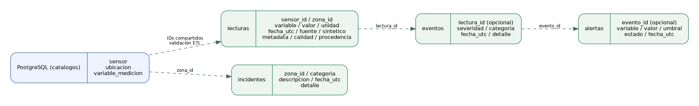
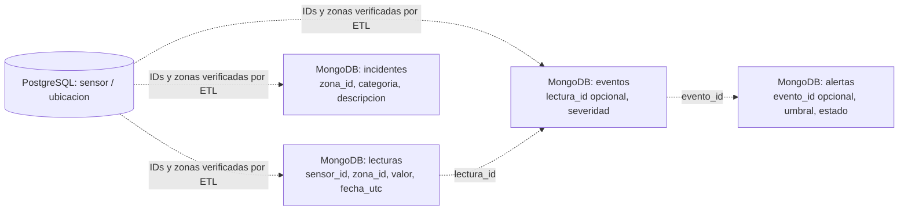

# Modelo documental de MongoDB — SmartCity Analytics (Edward)

**Estado del módulo:** modelo documental implementado y probado con lecturas EPA AQS 2025. Las colecciones, sus validadores y la carga funcionan en MongoDB 8.0. El contrato de identificadores corresponde al catálogo compartido con PostgreSQL.

## 1. Propósito
MongoDB almacena observaciones IoT semiestructuradas: lecturas, eventos, alertas e incidentes. PostgreSQL conserva los catálogos relacionales de sensores y ubicaciones. Las referencias entre motores son **lógicas**, no claves foráneas MongoDB.

## 2. Diagrama documental





**Cardinalidades conceptuales:** un sensor puede generar muchas lecturas; una lectura puede originar cero o varios eventos; un evento puede asociarse a alertas. Los incidentes también pueden registrarse sin una lectura específica. Estos enlaces no se imponen como FK dentro de MongoDB.

## 3. Colecciones y campos

| Colección | Campos indispensables | Campos opcionales o variables |
|---|---|---|
| `lecturas` | `sensor_id`, `zona_id`, `tipo_sensor`, `variable`, `valor`, `unidad`, `fecha_utc`, `fuente`, `sintetico` | `metadata`, `calidad`, `procedencia` |
| `eventos` | `sensor_id`, `zona_id`, `categoria`, `severidad`, `fecha_utc`, `fuente`, `sintetico` | `lectura_id`, `descripcion`, `detalle` |
| `alertas` | `sensor_id`, `zona_id`, `variable`, `valor`, `umbral`, `unidad`, `estado`, `fecha_utc`, `fuente`, `sintetico` | `evento_id`, `detalle` |
| `incidentes` | `zona_id`, `categoria`, `descripcion`, `fecha_utc`, `fuente`, `sintetico` | `sensor_id`, `detalle` |

`_id` existe en los cuatro tipos de documento y MongoDB lo exige/crea; **no** corresponde directamente a `id_sensor` ni al `BIGINT` de `medicion` en PostgreSQL.

## 4. Tipos y validadores

- `fecha_utc`: BSON Date con instante UTC; rangos `[inicio, fin)`.
- `valor` y `umbral`: BSON numérico (double, int, long o Decimal128). En la ingestión EPA se usa `Decimal128`, redondeado expresamente a seis decimales para alinearlo con el `NUMERIC(18,6)` PostgreSQL.
- `fuente`: string; `sintetico`: booleano obligatorio.
- Unidades PM: `µg/m³`; **no se mezclan** PM2.5 y PM10 sin separar `variable`.
- Se conserva el signo de los valores originales, incluidos negativos. Un valor negativo no se considera automáticamente válido desde el punto de vista físico.
- Los validadores del archivo `mongo/01_colecciones.js` utilizan `validationLevel: strict` y `validationAction: error`. No restringen campos adicionales para conservar la flexibilidad.

**Restricciones cruzadas que NO puede garantizar el validador:** que el `sensor_id` exista en PostgreSQL, que su `zona_id` coincida, que el código EPA represente la `variable` correcta o que dos documentos representen la misma observación. Esas verificaciones pertenecen al ETL y a la conciliación.

## 5. Ejemplos de variación documental

Lectura de PM2.5 con información de calidad:

```javascript
{
  sensor_id: 'EPA-01-003-0010-88101-3', // Ejemplo ilustrativo, no registro verificado
  variable: 'pm25',
  calidad: { calificador_epa: 'código_del_CSV' },
  procedencia: { parametro_epa: '88101', unidad_original: 'Micrograms/cubic meter (LC)' }
}
```

Lectura de PM10 con metadatos de otra forma:

```javascript
{
  variable: 'pm10',
  procedencia: { parametro_epa: '81102', unidad_original: 'Micrograms/cubic meter (25 C)' },
  metadata: { metodo: 'muestra_horaria', nota: 'información opcional' }
}
```

Los fragmentos muestran **campos variables**, no documentos completos. La prueba ejecutable `mongo/02_muestra.js` incluye documentos completos y válidos. Ni los calificadores ni las condiciones originales se inventan para registros reales.

## 6. Embebido frente a referencias

- **Embebidos:** `procedencia`, `calidad`, `metadata` y `detalle` dependen de la observación/evento y se suelen consultar junto con ella. Embebirlos evita consultas adicionales.
- **Referencias:** `sensor_id`, `zona_id`, `lectura_id` y `evento_id` evitan copiar todos los detalles del sensor, zona o evento en cada documento.
- Se duplica deliberadamente `zona_id` y `tipo_sensor` como atributos de la lectura porque simplifican filtros y agrupamientos frecuentes; **el ETL verifica** su coherencia con el catálogo.

## 7. Unicidad, carga y consistencia

MongoDB admite muchas lecturas por sensor. No existe un índice único únicamente sobre `sensor_id`. `carga.py` construye `_id` determinístico a partir de sensor, variable, UTC, fuente y bandera sintética; usa `UpdateOne(..., upsert=True, $setOnInsert)` para que repetir la misma carga no agregue documentos duplicados. **Advertencia:** `$setOnInsert` no resuelve cambios de valor de una observación ya cargada, ni implementa versionado de revisiones de EPA; esta política debe validarse con el grupo.

## 8. Consultas e índices

Javier mantiene Q01–Q10 e índices. Su versión anterior utiliza `fecha` y sensores `S001`; para el nuevo contrato deberá actualizar `fecha` → `fecha_utc`, los parámetros EPA y las variables de PM. Los nuevos índices que se acuerden deben respetar esa nomenclatura y evaluar el costo de lectura/escritura.

## 9. Alcance de las verificaciones
Se comprobaron 500.000 lecturas mediante los conteos de MongoDB y se conciliaron los identificadores y zonas con el catálogo PostgreSQL, sin errores en los grupos evaluados. La conciliación no compara cada medición con Azure. Las consultas analíticas y los índices pertenecen al módulo de consultas de MongoDB del equipo. Los umbrales de eventos y alertas se utilizan exclusivamente para demostración académica.
