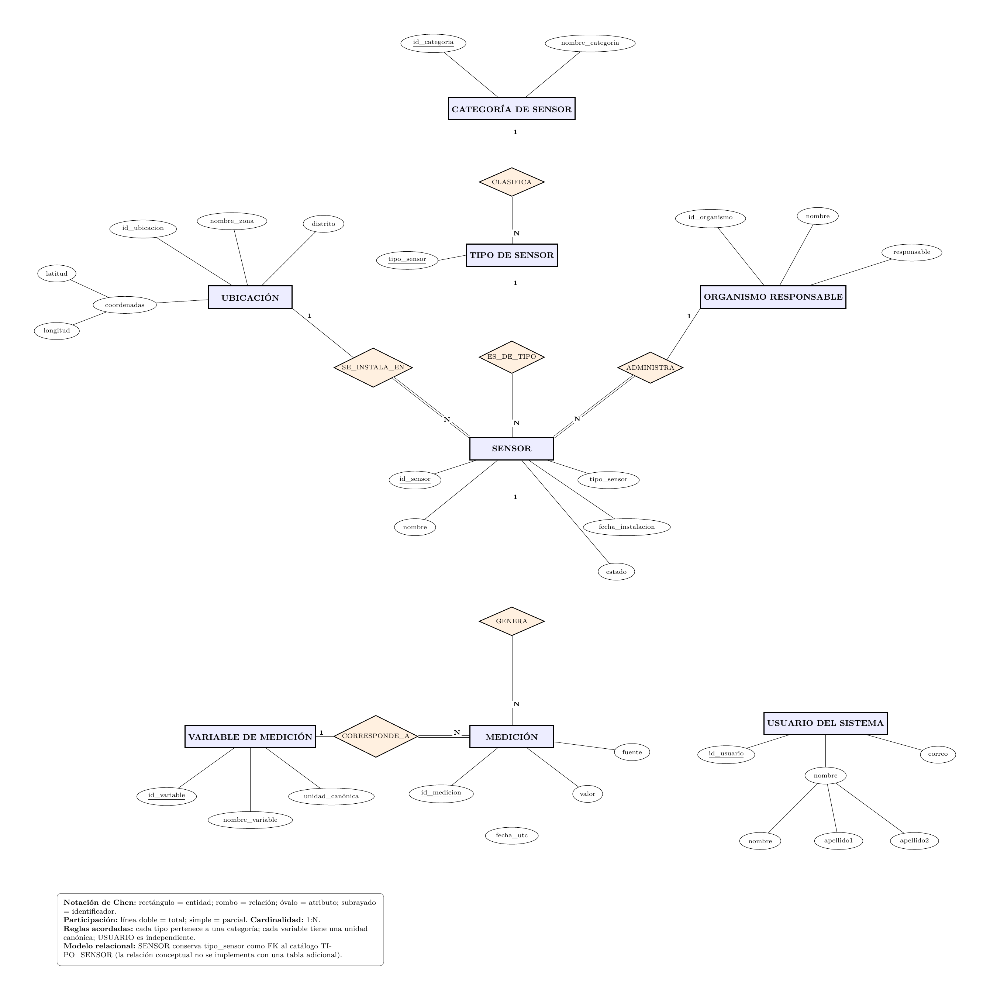
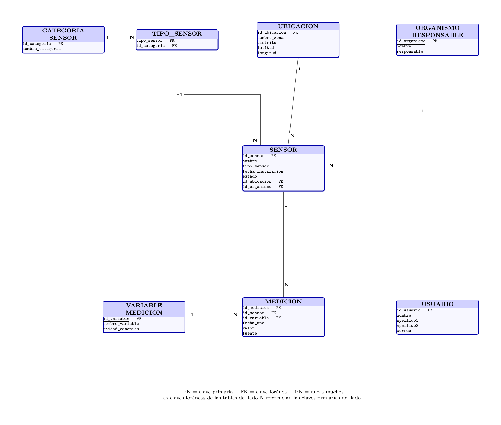

# SmartCity Analytics

Sistema de análisis de datos urbanos utilizando PostgreSQL,
MongoDB, Hadoop y Apache Spark.

## 1. PostgreSQL: Modelo e ingestión de datos

### 1.1 Modelo conceptual Chen



[Ver diagrama en PDF](../docs/postgres/modelo_chen.pdf)

### 1.2 Modelo lógico relacional



[Ver diagrama en PDF](../docs/postgres/modelo_relacional.pdf)

### 1.3 Normalización

### 1.3.1. Decisiones de diseño

Se parte de las cinco entidades mínimas exigidas en el enunciado (`SENSOR`, `UBICACION`, `CATEGORIA_SENSOR`, `USUARIO`, `ORGANISMO_RESPONSABLE`) y de la entidad `MEDICION` propuesta para el primer sprint. Se agregan dos entidades de catálogo para expresar las reglas de negocio acordadas:

- **TIPO_SENSOR:** cada tipo de sensor pertenece a una **única categoría**. El atributo `tipo_sensor` se conserva en `SENSOR`, ahora como referencia al catálogo de tipos.
- **VARIABLE_MEDICION:** cada variable tiene **una unidad canónica** compatible con el Sistema Internacional o aceptada para su uso con él. Las mediciones se convierten a esa unidad antes de almacenarse en PostgreSQL.

`USUARIO` se mantiene **independiente** de los organismos; puede representar a personas comunes. Su atributo compuesto `nombre` se desglosa en `nombre`, `apellido1` y `apellido2`; `coordenadas` en `latitud` y `longitud`.

> **Alcance:** estas dos entidades adicionales y las cardinalidades son decisiones del equipo para lograr consistencia; no aparecen como entidades mínimas obligatorias en el enunciado. Los nombres de las unidades y su conversión se confirmarán con las fuentes de datos reales.

### 1.3.2. Transformación de Chen al modelo relacional

Cada entidad se convierte en una tabla. En cada relación **1:N** se añade al lado **N** una FK hacia la PK del lado **1**, sin tabla intermedia. Las participaciones totales acordadas se traducen a FK `NOT NULL`.

```text
UBICACION(
  id_ubicacion [PK], 
  nombre_zona, 
  distrito, 
  latitud, 
  longitud
)

CATEGORIA_SENSOR(
  id_categoria [PK], 
  nombre_categoria
)

TIPO_SENSOR(
  tipo_sensor [PK],
  id_categoria [FK -> CATEGORIA_SENSOR(id_categoria)]
)

ORGANISMO_RESPONSABLE(
  id_organismo [PK], 
  nombre, 
  responsable
)

USUARIO(
  id_usuario [PK], 
  nombre, 
  apellido1, 
  apellido2, 
  correo
)

SENSOR(
  id_sensor [PK], 
  nombre,
  tipo_sensor [FK -> TIPO_SENSOR(tipo_sensor)],
  fecha_instalacion, 
  estado,
  id_ubicacion [FK -> UBICACION(id_ubicacion)],
  id_organismo [FK -> ORGANISMO_RESPONSABLE(id_organismo)]
)

VARIABLE_MEDICION(
  id_variable [PK], 
  nombre_variable, 
  unidad_canonica
)

MEDICION(
  id_medicion [PK],
  id_sensor [FK -> SENSOR(id_sensor)],
  id_variable [FK -> VARIABLE_MEDICION(id_variable)],
  fecha_utc, 
  valor, 
  fuente
)
```

#### Relaciones transformadas

| Relación Chen | Cardinalidad | FK en el modelo relacional | Participación total |
|---|---|---|---|
| UBICACION — SE_INSTALA_EN — SENSOR | 1:N | `SENSOR.id_ubicacion` | SENSOR |
| CATEGORIA_SENSOR — CLASIFICA — TIPO_SENSOR | 1:N | `TIPO_SENSOR.id_categoria` | TIPO_SENSOR |
| TIPO_SENSOR — ES_DE_TIPO — SENSOR | 1:N | `SENSOR.tipo_sensor` | SENSOR |
| ORGANISMO_RESPONSABLE — ADMINISTRA — SENSOR | 1:N | `SENSOR.id_organismo` | SENSOR |
| SENSOR — GENERA — MEDICION | 1:N | `MEDICION.id_sensor` | MEDICION |
| VARIABLE_MEDICION — CORRESPONDE_A — MEDICION | 1:N | `MEDICION.id_variable` | MEDICION |

**Resultado:** 8 tablas, 8 claves primarias y 6 claves foráneas. Se permiten sensores sin mediciones y usuarios sin organismo asociado.

### 1.3.3. Normalización

#### 1.3.3.1. Primera Forma Normal (1FN)

**Criterio:** valores atómicos, sin grupos repetitivos.

**Aplicación:** se descompone `coordenadas` en `latitud` y `longitud`, y el nombre compuesto de `USUARIO` en `nombre`, `apellido1` y `apellido2`. Cada registro de `MEDICION` almacena una observación con valor numérico y fecha.

**Resultado:** las ocho relaciones se plantean en **1FN**.

#### 1.3.3.2. Segunda Forma Normal (2FN)

**Criterio:** cumplir 1FN y no tener dependencias parciales respecto de una clave candidata compuesta.

**Aplicación:** las claves primarias propuestas son simples (`id_ubicacion`, `id_categoria`, `tipo_sensor`, `id_organismo`, `id_usuario`, `id_sensor`, `id_variable`, `id_medicion`). No hay dependencias parciales respecto de esas claves; se deberán revisar otras posibles claves candidatas al fijar las restricciones definitivas.

**Resultado:** se satisface **2FN** bajo las claves y dependencias de negocio declaradas.

#### 1.3.3.3. Tercera Forma Normal (3FN)

**Criterio formal:** para cada dependencia funcional no trivial `X -> A`, `X` debe ser superclave o `A` debe ser atributo primo de alguna clave candidata.

**Problema 1 — SENSOR (diseño anterior):**

```text
id_sensor -> tipo_sensor -> id_categoria
```

Si cada tipo tiene una sola categoría, `tipo_sensor -> id_categoria` crea una dependencia transitiva problemática en la tabla SENSOR anterior. **Normalización:** mover esa asociación a `TIPO_SENSOR(tipo_sensor, id_categoria)`, conservar `SENSOR.tipo_sensor` como FK y eliminar `SENSOR.id_categoria`.

**Problema 2 — MEDICION (diseño anterior):**

```text
id_medicion -> variable -> unidad
```

Si cada variable se almacena con una unidad canónica, `variable -> unidad` crea una dependencia transitiva problemática en MEDICION. **Normalización:** definir `VARIABLE_MEDICION(id_variable, nombre_variable, unidad_canonica)` y sustituir `variable`/`unidad` en MEDICION por `id_variable` como FK.

**Dependencias funcionales fundamentales del esquema nuevo:**

| Tabla | Dependencia funcional prevista |
|---|---|
| `UBICACION` | `id_ubicacion -> nombre_zona, distrito, latitud, longitud` |
| `CATEGORIA_SENSOR` | `id_categoria -> nombre_categoria` |
| `TIPO_SENSOR` | `tipo_sensor -> id_categoria` |
| `ORGANISMO_RESPONSABLE` | `id_organismo -> nombre, responsable` |
| `USUARIO` | `id_usuario -> nombre, apellido1, apellido2, correo` |
| `SENSOR` | `id_sensor -> nombre, tipo_sensor, fecha_instalacion, estado, id_ubicacion, id_organismo` |
| `VARIABLE_MEDICION` | `id_variable -> nombre_variable, unidad_canonica` y, si nombre es único, `nombre_variable -> id_variable, unidad_canonica` |
| `MEDICION` | `id_medicion -> id_sensor, id_variable, fecha_utc, valor, fuente` |

**Resultado:** se eliminaron las **dos dependencias transitivas identificadas**. Con las dependencias de negocio declaradas y sin otras dependencias adicionales, el esquema propuesto **satisface 3FN**. Esta conclusión requiere confirmar las claves candidatas, la unicidad de nombres de catálogo y el significado exacto de `responsable`, `nombre_zona` y `fuente` al validar los datos reales; no equivale aún a una prueba exhaustiva frente a cualquier conjunto de datos.

